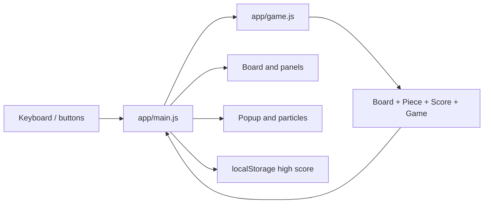

# Architecture

## Runtime layers

### Game core: `app/game.js`

- `Board`: sentinel-wall matrix, placement, locking, line clearing, drop
  distance.
- `Piece`: 4x4 tetromino data, random selection, clockwise matrix rotation.
- `Score`: line points, total lines, and level.
- `Game`: active/next piece, coordinates, movement, wall kicks, gravity,
  locking, spawn, pause and game-over state.

### Application/presentation: `app/main.js`

Creates the DOM cell grid, projects the ghost piece, renders state, translates
keyboard commands, controls overlays, persists high score, and creates
presentation-only line-clear particles and messages.

### Styling: `app/styles.css`

Defines the light theme, responsive layout, rounded gradient blocks, ghost
cells, overlays, reduced-motion behavior, and effects animation.

## Preserved C++ architecture

`src/Board.*`, `Piece.*`, `Score.*`, `Game.*`, `Input.*`, and `Renderer.*`
remain a separate console implementation. `legacy/Tetris.cpp` is the original
single-file reference. The browser does not import or execute C++.

## State and dependency boundaries

Core modules do not access the DOM, localStorage, or CSS. The UI reads core
state and issues commands. Effects are triggered only from returned
`clearedRows`, so they cannot alter board mutation order.
